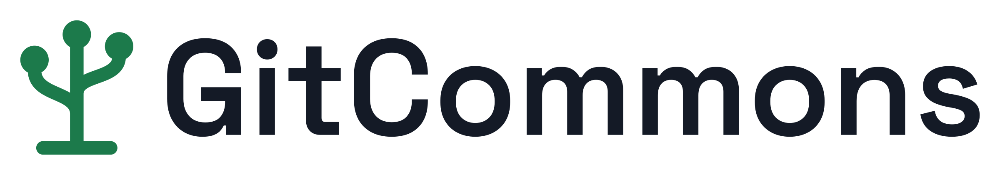

# GitCommons logo

A Git branch graph drawn as a tree standing on shared ground. The trunk and its two branches each end in a commit, and the line under the trunk is the common: land a community holds together.

| Part | Color |
| --- | --- |
| App tile, and the symbol on light | Meadow `#1c7a4b` |
| Symbol on the app tile and on dark | Ivory `#f7f5ec` |

The wordmark is **GitCommons** in Space Grotesk SemiBold: ink `#141a26` on light, ivory on dark.

## Files

| File | Use |
| --- | --- |
| [gitcommons-logo-on-light.svg](gitcommons-logo-on-light.svg) · [PNG](gitcommons-logo-on-light.png) | Full logo, light backgrounds |
| [gitcommons-logo-on-dark.svg](gitcommons-logo-on-dark.svg) · [PNG](gitcommons-logo-on-dark.png) | Full logo, dark backgrounds |
| [gitcommons-mark-on-light.svg](gitcommons-mark-on-light.svg) · [PNG](gitcommons-mark-on-light.png) | Symbol only, light backgrounds |
| [gitcommons-mark-on-dark.svg](gitcommons-mark-on-dark.svg) · [PNG](gitcommons-mark-on-dark.png) | Symbol only, dark backgrounds |
| [gitcommons-app-icon.svg](gitcommons-app-icon.svg) · [PNG](gitcommons-app-icon.png) | Meadow tile with rounded corners |
| [gitcommons-app-icon-square.svg](gitcommons-app-icon-square.svg) · [PNG](gitcommons-app-icon-square.png) | Full-bleed square for platforms that apply their own mask (iOS, Android adaptive, PWA maskable). The symbol is smaller so it stays inside the maskable safe zone |
| [gitcommons-favicon.svg](gitcommons-favicon.svg) · [PNG](gitcommons-favicon.png) | Browser tab icon; the PNG is 64 px |

SVGs are filled outlines with no strokes or font dependency. Logo and symbol PNGs are transparent: logos 2400 px wide, symbols 1024 px tall. App icon PNGs are 1024 px square.

## Construction

- The symbol sits on a 100-unit grid. Every line is 8 units wide with round ends, and each commit is a circle of radius 8.4.
- The trunk runs from the ground at y = 86 up to y = 24. The ground line is 40 units wide.
- The branches are cubic curves that leave the trunk vertically at y = 66 and y = 54 and arrive vertically under their commits, 25 units to either side.
- The wordmark is [Space Grotesk](https://github.com/google/fonts/tree/main/ofl/spacegrotesk) at weight 600, converted to outlines, set at 80 units with its capital height centred on the symbol and a 20-unit gap. The font and its SIL Open Font License 1.1 are in [fonts/](fonts/).
- On the app tile the symbol is scaled to 90% and the corner radius is 23 units; on the full-bleed square it is scaled to 72%.

[build.py](build.py) regenerates every file: `uv run build.py` (PNGs need `rsvg-convert`).

[options.html](options.html) is the interactive sheet this was chosen from: open it in a browser to compare the nine directions and test them at favicon, app icon and header sizes.
